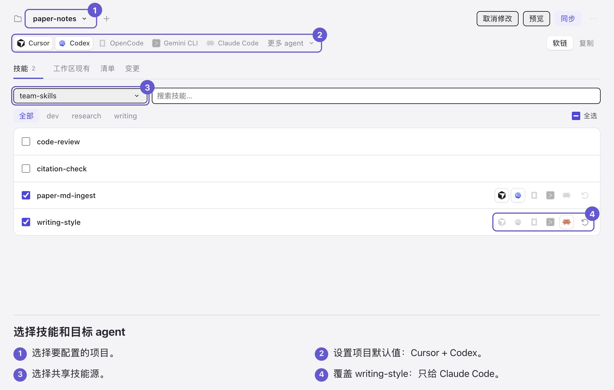
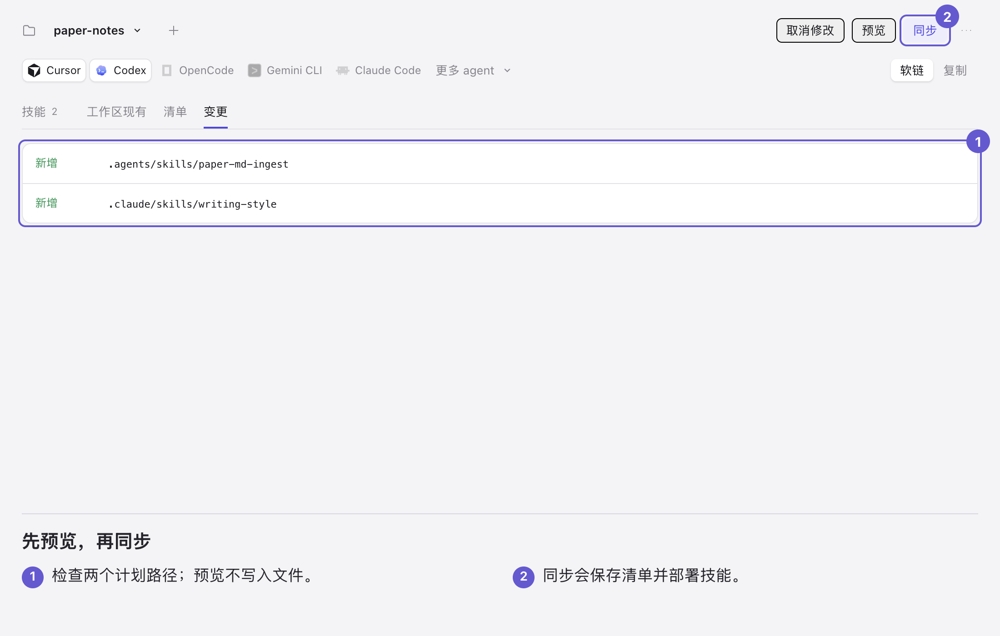
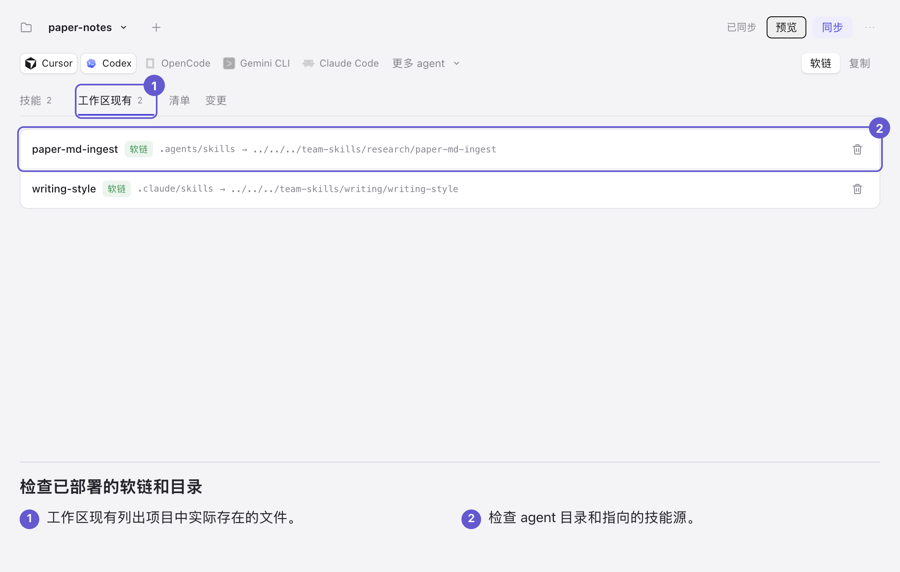
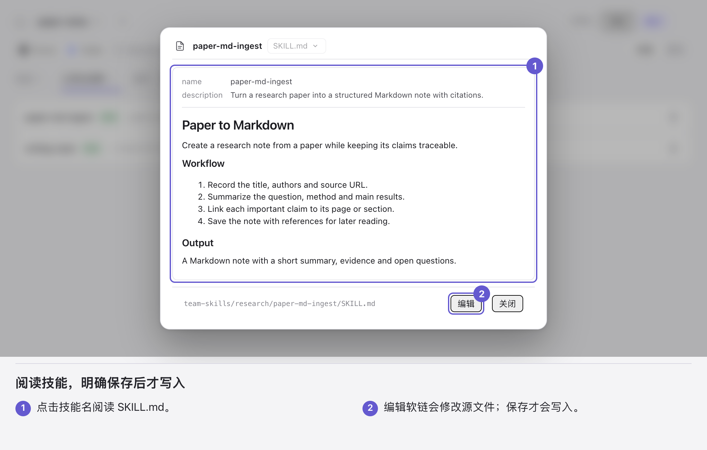

<div align="center">
<a name="readme-top"></a>


# Kago

为每个项目配好 Agent Skills。

Kago 是一个 Magpie 插件，从共享来源挑选技能，用一份纳入 Git 的清单部署每个项目需要的一套。

[English](README.md) · **简体中文**

<br/>

<a href="https://github.com/ffy6511/Kago/stargazers"></a>
<a href="https://github.com/ffy6511/Kago/commits/main"></a>
<a href="LICENSE"></a>
<a href="https://nodejs.org"></a>
<a href="docs/integration.md"></a>

</div>

<details>
<summary><kbd>目录</kbd></summary>

- [特性](#features)
- [安装](#install)
- [使用教程](#walkthrough)
- [更新与移除技能](#manage-skills)
- [清单](#manifest)
- [文件安全](#file-safety)
- [CLI](#cli)
- [开发](#development)
- [文档](#docs)
- [许可证](#license)

<br/>

</details>

<a name="features"></a>

## 特性

- **唯一真源**：每个仓库一份 `skills.manifest.yaml`，定义来源、agent 和部署方式。
- **按项目精细部署**：每个项目只拿它需要的技能；共享 agent 目录自动去重。
- **软链或复制**：默认相对软链；受限 agent 或需要自包含文件的仓库可以选择复制。
- **所有权保护**：指纹保护部署产物；完全一致的替换自动接管；本地修改会阻止清理。
- **整目录软链修复**：明确确认后，把 `.agents/skills` 整目录链接替换为真实目录。
- **页面与 CLI 共用引擎**：在 Magpie 里预览，在 CLI 里自动化；同一套计划、加锁和恢复逻辑。

<a name="install"></a>

## 安装

直接安装已发布的插件：

```sh
magpie plugin add @jhzhuo/kago
```

打开 **Magpie → 插件 → Kago**。本地服务会自动启动，默认端口为 `3498`，可在插件 Options 中修改。卸载使用 `magpie plugin rm @jhzhuo/kago`。

### 从源码安装

```sh
git clone https://github.com/ffy6511/Kago.git
cd Kago
bun install --frozen-lockfile
```

安装本地插件：

```sh
magpie plugin add /absolute/path/to/Kago
```

以源码路径安装时使用的是当前 checkout，改完代码后重新加载插件即可。卸载使用 `magpie plugin rm /absolute/path/to/Kago`。

<a name="walkthrough"></a>

## 使用教程

下面为 `paper-notes` Git 项目配上共享目录 `team-skills` 中的两个技能。每个技能都是一个包含 `SKILL.md` 的目录，其 frontmatter 需要有与目录名一致的 `name` 和非空的 `description`。

<table>
  <tr>
    <td width="50%" align="center" valign="top">
      <a href="docs/images/select-zh.png"></a><br>
      <strong>1. 选择技能</strong><br>
      <sub>设置项目默认 agent，再为单个技能覆盖。</sub>
    </td>
    <td width="50%" align="center" valign="top">
      <a href="docs/images/preview-zh.png"></a><br>
      <strong>2. 预览路径</strong><br>
      <sub>检查实际变更；点击同步后才写入文件。</sub>
    </td>
  </tr>
  <tr>
    <td width="50%" align="center" valign="top">
      <a href="docs/images/existing-zh.png"></a><br>
      <strong>3. 检查部署</strong><br>
      <sub>核对实际软链、agent 目录和来源目标。</sub>
    </td>
    <td width="50%" align="center" valign="top">
      <a href="docs/images/reader-zh.png"></a><br>
      <strong>4. 阅读与编辑</strong><br>
      <sub>打开 SKILL.md；明确保存后才写入文件。</sub>
    </td>
  </tr>
</table>

```text
workspace/
├── team-skills/
│   ├── dev/code-review/SKILL.md
│   ├── research/citation-check/SKILL.md
│   ├── research/paper-md-ingest/SKILL.md
│   └── writing/writing-style/SKILL.md
└── paper-notes/
    └── .git/
```

### 1. 登记来源和项目

在 Magpie 侧边栏打开 **Kago**。从 **…** 菜单选择 **添加来源**，填入 `team-skills` 的绝对路径。登记包含分类文件夹的根目录，Kago 会递归扫描其中的技能。**读取 Magpie Library** 会将 Magpie 已有的技能库添加为来源。

点击项目选择器旁的 **+**，填入 `paper-notes` 的绝对路径；这个目录需要是 Git 仓库。可选的清单路径留空，即使用项目根目录下的 `skills.manifest.yaml`。点击 **同步** 时部署选中的技能。

### 2. 选择技能和目标 agent

1. 顶部选择 **paper-notes** 项目，来源选择 **team-skills**。用分类和搜索缩小技能列表。
2. 顶部 agent 行启用 **Cursor** 和 **Codex**。没有单独覆盖的技能会继承这组默认值。
3. 勾选 **paper-md-ingest** 和 **writing-style**。点击行内空白处切换勾选，点击技能名打开文档。
4. 在 `writing-style` 行关闭 Cursor、Codex，再启用 **Claude Code**。右侧重置按钮可恢复项目默认值。

选择 **软链** 会建立指向源目录的相对链接。agent 需要工作区内的实际文件时，例如受限或远程环境，选择 **复制**。复制后的文件在下次同步时接收来源更新。显式取消所有目标 agent，表示这个技能不部署到任何地方。

勾选结果在同步前保留为草稿。**取消修改** 会恢复打开项目或上次同步时的状态，不写入项目文件。

### 3. 预览实际写入路径

点击 **预览** 打开 **变更**。这里的 `paper-md-ingest` 只创建一个由 Cursor、Codex 共用的 `.agents/skills` 条目，`writing-style` 创建一个 `.claude/skills` 条目。预览会保留清单和部署文件的原样。

继续前检查 **新增**、**更新**、**移除** 和 **冲突**。发生冲突时，页面会列出需要处理的路径。**清单** 页签显示当前选择对应的 YAML，也支持直接编辑。

### 4. 同步并检查结果

点击 **同步**。Kago 校验当前草稿、规划文件变更，写入 `skills.manifest.yaml` 并部署选中的技能。完成后顶部显示 **已同步**。打开 **工作区现有**，检查项目中实际存在的软链或目录：

```text
paper-notes/
├── skills.manifest.yaml
├── .agents/skills/
│   └── paper-md-ingest → ../../../team-skills/research/paper-md-ingest
└── .claude/skills/
    └── writing-style → ../../../team-skills/writing/writing-style
```

把清单提交到项目的 Git 仓库。Kago 会在自己的 `.gitignore` 托管块中排除生成的部署路径。对相同配置再次预览时，这些条目显示为 **一致**。

### 5. 阅读与编辑技能文档

在 **技能** 或 **工作区现有** 中点击技能名打开文档。顶部文件选择器可以切换该技能内的文件。**编辑 → 保存** 会写入当前文件；取消编辑、切换文件或关闭前都会保护尚未保存的修改。

编辑技能源或已部署的软链时，修改的是源文件；编辑已部署的真实目录时，修改的是该目录。复制部署需要再次同步才会接收来源更新，复制目录中的本地修改会阻止覆盖，处理后才能继续。

<a name="manage-skills"></a>

## 更新与移除技能

- **新增或调整选择**：勾选技能、调整 agent，再执行 **预览 → 同步**。**… → 同步全部项目** 会应用各个已登记项目保存在磁盘上的清单。
- **移除托管部署**：取消勾选技能，预览移除计划，再同步。自动清理只移除 Kago 托管且未被修改的产物；本地修改和未托管文件会受到保护。
- **理解状态标签**：**已存在** 表示发现匹配来源的软链或完整的托管副本；取消勾选后变成 **将移除**。未托管的软链也可能显示已存在，识别结果不会授予 Kago 所有权或自动删除权限。
- **删除指定工作区条目**：**工作区现有** 的删除按钮会确认准确路径。删除软链保留它的目标；删除真实目录会移除该目录及其中内容。这个操作不更新清单，仍被选中的技能会在之后同步时重新创建。
- **停止托管项目**：**… → 取消托管** 保留部署文件，并放弃 Kago 的所有权记录。

如果预览提示 `.agents/skills` 是整目录软链，先检查 **修复** 对话框里的链接和目标。确认后只将该链接替换成真实目录，保留链接目标；同步前再次检查计划。其他所有权与恢复操作见 [CLI 与恢复](docs/cli.md)。

<a name="manifest"></a>

## 清单

```yaml
version: 1
ssot: ../team-skills
defaults:
  agents: [cursor, codex]
deploy:
  method: link
skills:
  - name: paper-md-ingest
    path: research/paper-md-ingest
  - name: writing-style
    path: writing/writing-style
    agents: [claude]
```

`ssot` 相对于清单文件，或使用绝对路径。技能目录名必须与 YAML frontmatter 里的 `name` 一致。省略 `path` 时会解析唯一扫描到的同名技能。未知字段、重复名称、不安全路径和不支持的 agent ID 都会让校验失败。显式写空的 agent 列表表示不部署到任何地方。

Cursor、Codex、OpenCode、Gemini CLI 共用 `.agents/skills`，Claude Code 使用 `.claude/skills`。多个 agent 指向同一目录时只生成一份产物。清单应当提交到 Git；生成的产物由插件自己的 `.gitignore` 托管块排除。

<a name="file-safety"></a>

## 文件安全

- 预览不写项目文件。同步会重新检查每个目标，拒绝未托管冲突，并在规划成功后写入清单。
- 所有权指纹保护部署产物；完全一致的替换自动接管，本地修改会阻止清理。
- 每次替换都会记入日志，跨进程锁串行化 CLI 和页面的写入。写入假设本机进程是协作式的。
- `.agents/skills` 是软链时会阻止同步。页面可以在确认后把链接替换为真实目录，确认框会显示目标；链接目标本身不受影响。更高层的链接仍需手工处理。
- 相对软链可能指向仓库外；受限 agent 请选 **复制**。技能源内部的嵌套软链会被拒绝。
- Magpie Library 技能可以作为来源，包括顶层目录链接。插件不会修改 `library.json` 或全局 agent 开关；Magpie Projects 已生成的产物属于未托管冲突。

<a name="cli"></a>

## CLI

CLI 与页面读取同一份清单。先登记来源和项目，按上面的示例或通过页面创建 `skills.manifest.yaml`，再预览和应用：

```sh
node cli.mjs source add /path/to/team-skills
node cli.mjs project add /path/to/paper-notes
node cli.mjs plan /path/to/paper-notes
node cli.mjs apply /path/to/paper-notes
```

以下命令可查看登记状态，以及同步所有项目保存在磁盘上的清单：

```sh
node cli.mjs status
node cli.mjs sync
```

需要 Node 22 或更新版本，并已安装依赖（`bun install`）。只使用 CLI 时，可执行 `npm install --global @jhzhuo/kago`，再用 `kago` 替代 `node cli.mjs`。`--config-dir` 隔离状态；`--magpie-dir` 选择 Library 配置根目录。

<a name="development"></a>

## 开发

```sh
bun install --frozen-lockfile
bun run test
bun run check
bun run format:check
```

推送和 PR 会在 Ubuntu、macOS 上使用 Node 22、24 运行检查。发版时更新包版本，在 `docs/releases/` 添加双语说明，合并到 `main` 后推送对应的 `vMAJOR.MINOR.PATCH` 标签；工作流会发布 npm 并创建 GitHub Release。首次使用需完成 [npm 授权配置](docs/distribution.md#one-time-npm-setup)。

<a name="docs"></a>

## 文档

| 文档                             | 内容                           |
| -------------------------------- | ------------------------------ |
| [CLI 与恢复](docs/cli.md)        | 命令、所有权、中断后的处理     |
| [界面流程](docs/ui.md)           | 页面控件、冲突修复、源文件编辑 |
| [集成契约](docs/integration.md)  | Magpie host、本地服务与包边界  |
| [验证记录](docs/verification.md) | 历史验收记录                   |
| [市场分发](docs/distribution.md) | 打包与分发边界                 |
| [规格](docs/spec.md)             | 范围、行为契约与验收           |

<a name="license"></a>

## 许可证

[MIT](LICENSE)

<div align="right">

[返回顶部 ↑](#readme-top)

</div>
